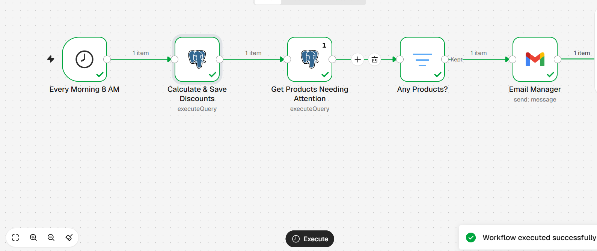
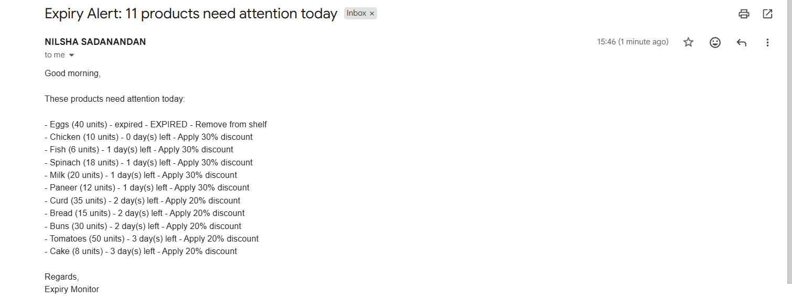
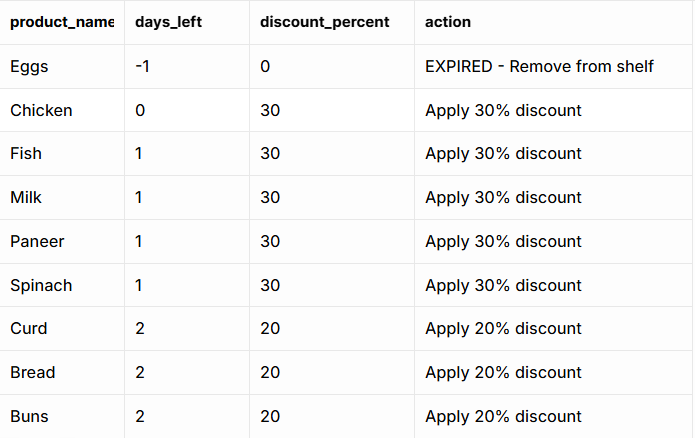
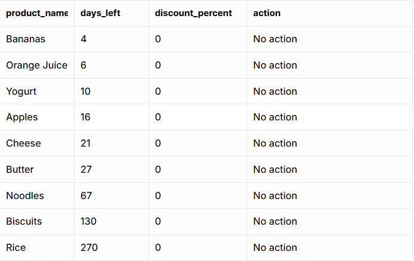
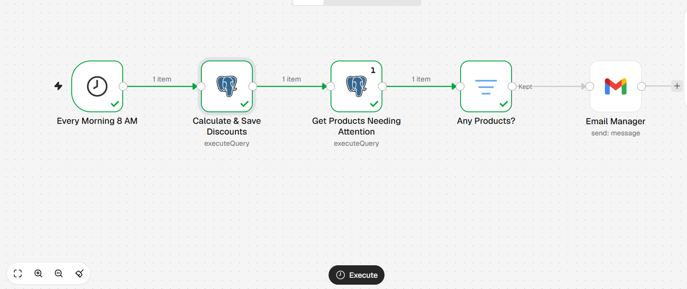

# n8n Expiry Automation (Member 3: Nilsha)

## What this part does
An n8n workflow checks every product's expiry date each morning at 8 AM and saves the right discount to the database. It then emails the manager a list of products that need attention. If nothing needs attention, no email is sent.

## Tasks completed
| Task | What was done | Result |
|---|---|---|
| 3.1 | Imported the workflow into n8n and connected it to my own Supabase | Test run succeeded |
| 3.2 | Built the daily workflow: schedule, calculate and save discounts, get expiring products | Discounts saved in the database. Tested by running it manually; the 8 AM schedule starts once the workflow is published |
| 3.3 | Added the manager alert email and "no email if nothing is expiring" | Correct email received: 11 products on the first sample data, 31 after the database update; no email sent when nothing was expiring |
| 3.4 | Tested expired, today, 1 to 3 days and none, then exported the JSON to `n8n/` | All cases passed |

## Tools used
n8n Cloud (Schedule, PostgreSQL, Filter and Gmail nodes), PostgreSQL on Supabase

## How it works (steps)
1. The Schedule node starts the workflow every day at 8 AM.
2. A PostgreSQL node updates every product: 1 day or less left gets 30%, 2 to 3 days left gets 20%, and expired products get 0% and "EXPIRED - Remove from shelf".
3. A second PostgreSQL node counts the in-stock products that are expired or have 3 days or less left, and builds the text list.
4. A Filter node stops the workflow if the count is 0.
5. The Gmail node sends the count and list to the manager.

The dashboards and the public offers page read the `products_live` and `customer_offers` views, which work out the same discounts from today's date. The workflow saves the discounts in the `products` table and emails the manager.

## Screenshots

## Testing
First tested on the original sample data (20 products), then again after the database update (59 products). The screenshots are from the first test.

| Test | Expected | Result |
|---|---|---|
| Expired (Eggs, -1 day) | 0%, "EXPIRED - Remove from shelf" | Pass |
| Expires today (Chicken) | 30% | Pass |
| 1 day left (Milk, Fish, Paneer, Spinach) | 30% | Pass |
| 2 to 3 days left (Curd, Bread, Buns, Tomatoes, Cake) | 20% | Pass |
| 4 or more days left (Bananas, Yogurt and others) | 0%, "No action" | Pass |
| Manager alert email | One email listing every product that needs attention | Pass: 11 on the original data, 31 on the updated data |
| Out of stock (Strawberries, Veg Sandwich) | Left out of the email | Pass |
| Saved discounts match the `products_live` view | 0 products differ | Pass |
| Offers page (`customer_offers`) after the run | 24 products | Pass |
| Nothing expiring within 3 days | Workflow stops, no email | Pass |

## Problems faced and how we solved them
- n8n Cloud could not reach Supabase's direct connection, so we used the Session pooler.
- The connection failed with a "self-signed certificate" error, so we turned on "Ignore SSL Issues" in the n8n credential.
- The placeholder address manager@example.com cannot receive mail, so testing used a real inbox. The placeholder was restored in the exported file to keep personal details out of GitHub.
- The first test email listed 13 products instead of 11 because sample dates are set when database.sql runs. Re-running the script gave the expected result.
