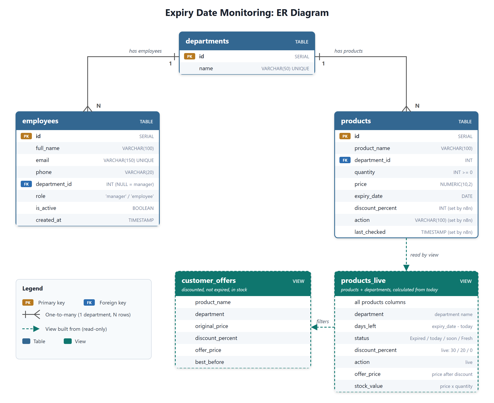

# Database Design (Member 2: Cindra)

## What this part does
The database stores all the data for the system: departments, employees and products with their expiry dates. Every other part of the project (the n8n automation, the dashboards and the customer offers page) reads from or writes to this database. It also calculates live discounts, so the dashboards always show the correct discount for today's date.

## Tools used
- **PostgreSQL**, hosted on **Supabase** (free plan)
- Supabase **SQL Editor** to run the script and **Table Editor** to check the data
- **GitHub** for version control (`database/database.sql`)

## How it works (steps)
1. A single script, `database/database.sql`, creates all tables and views and loads the sample data. Running it again resets the database to a clean demo state.
2. **Tables:**
   - `departments`: the 8 store departments (Dairy, Bakery, Meat, Vegetables, Fruits, Beverages, Snacks, Grocery)
   - `employees`: staff details, their department and role (`manager` or `employee`). The email matches the Budibase login, so each employee only sees their own department.
   - `products`: name, department, quantity, price and expiry date. n8n also saves `discount_percent`, `action` and `last_checked` here every morning.
3. **Relationships:** one department has many employees, and one department has many products (one-to-many, using `department_id` as a foreign key). The manager has no department.
4. **Views (read-only):**
   - `products_live` calculates `days_left`, `status`, `discount_percent`, `action`, `offer_price` and `stock_value` from today's date every time it is read. The dashboards read from this view, so the discount is correct even before n8n runs.
   - `customer_offers` shows only products that have a discount, are not expired and are in stock. The public offers page uses it.
5. **Discount rules** (the same in the view and in n8n):

   | Days left | Discount | Action |
   |---|---|---|
   | Less than 0 | 0% | EXPIRED - Remove from shelf |
   | 0–1 | 30% | Apply 30% discount |
   | 2–3 | 20% | Apply 20% discount |
   | More than 3 | 0% | No action |

6. **Sample data:** 59 products, 10 employees (1 manager, 1 per department, 1 inactive). Expiry dates are set relative to the day the script is run, so the demo always shows every case.
7. **Security:** Row Level Security is turned on for all tables. This blocks the public Supabase API, while Budibase and n8n still connect directly as the database owner.

## Screenshots

## Testing
| Test | Expected | Result |
|---|---|---|
| Run `database.sql` on a new Supabase project | 8 departments, 10 employees, 59 products | Pass |
| Count products by action in `products_live` | 30%: 16, 20%: 10, expired: 7, no action: 26 | Pass |
| Product expiring tomorrow (Milk) | 30% discount, offer price ₹21.00 | Pass |
| Expired product (Eggs) | Not shown in `customer_offers` | Pass |
| Out of stock product with a discount (Strawberries) | Not shown in `customer_offers` | Pass |
| Product with more than 3 days left (Yogurt) | 0% discount, "No action" | Pass |
| Run the script a second time | Tables reset with fresh dates, no errors | Pass |

## Problems faced and how we solved them
- **Discounts were only updated once a day.** n8n saves the discount every morning, so a product added during the day had no discount until the next morning. We added the `products_live` view, which calculates the discount from today's date every time it is read.
- **Sample data became out of date.** A few days after running the script, most products showed as expired. We made all expiry dates relative to the day the script is run (`CURRENT_DATE + days`), so running it again refreshes the demo.
- **Supabase warned that the tables had no Row Level Security.** We added `ENABLE ROW LEVEL SECURITY` to the script, which blocks the public API without affecting Budibase and n8n.
- **Connecting from other tools.** The direct connection needs IPv6, which some tools do not support. We shared the **Session pooler** connection details with the team instead.
- **Keeping the team in sync.** Every member depends on the table and column names, so we kept them unchanged, documented everything in `database/README.md`, and only added new views instead of changing existing tables.
