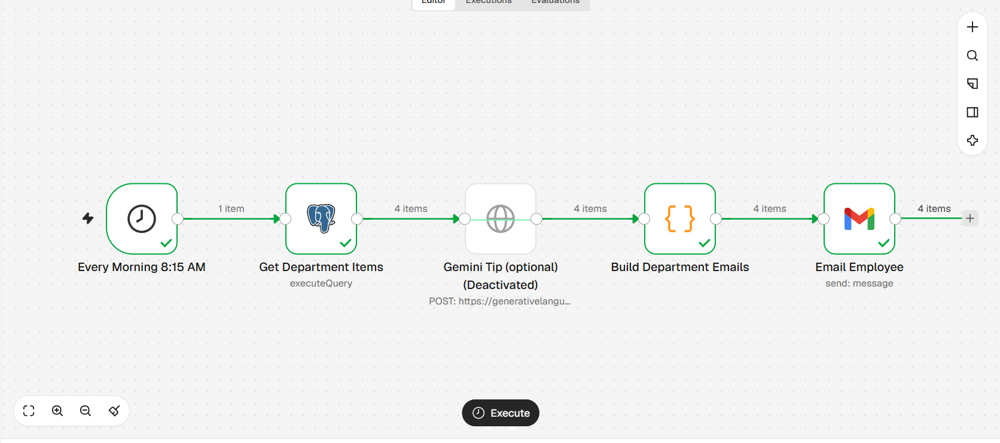
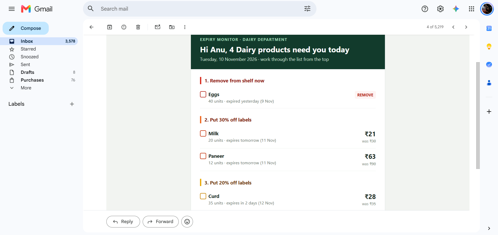

# Notifications & AI (Member 4: Nayma Madhu)

## What this part does
Every morning at 8:15 AM, an n8n workflow sends each department employee an email that lists only their own department's products that need action today: what to remove from the shelf and which items need a 30% or 20% discount label. This turns the expiry data into a short task list for each employee. The store manager still gets the full report for all departments from the expiry check workflow (Member 3).

## Tools used
- **n8n Cloud**: Schedule Trigger, Postgres, Code (JavaScript), HTTP Request and Gmail nodes
- **PostgreSQL (Supabase)**: `employees`, `departments` and `products` tables
- **Gmail**: sends the emails as HTML
- **Google Gemini API** (optional): suggests an extra discount for products that may not sell in time

## How it works (steps)
1. **Every Morning 8:15 AM** starts the workflow (timezone Europe/Berlin), 15 minutes after the expiry check has saved the day's discounts.
2. **Get Department Items** runs one SQL query that returns one row per active employee, with their department's products that expire within 3 days and are still in stock. It uses the same discount rule as the expiry check: expired → remove, 0–1 days left → 30% off, 2–3 days left → 20% off. Employees with nothing to do get no row, so they get no email.
3. **Gemini Tip (optional)** sends each department's products to Gemini. Gemini picks the product most likely to go unsold, based on days left and quantity, and suggests a discount and a shelf tip. This node is switched off by default. When it is off or fails, the email is still sent without the tip.
4. **Build Department Emails** (Code node) builds an HTML email for each employee from the alert layout we designed. Products are grouped into three numbered steps: Remove from shelf now, Put 30% off labels, Put 20% off labels. Each product shows quantity, expiry date and the new price in large type, so it can be copied onto the label.
5. **Email Employee** (Gmail node) sends one email to each employee, with a subject such as "Dairy: 4 products to handle today".

### Email design (task 4.1)
We designed two versions of the alert email with the same three colour-coded groups (red = expired, orange = 30% off, yellow = 20% off):
- **Manager version:** all departments, with stock value at risk, money that can still be recovered, and who received a department alert.
- **Department version:** only the employee's own department, as a checklist with the new prices.

The layouts are in `n8n/email-templates/`. They use tables and inline styles so they display correctly in Gmail on desktop and phone.

## Screenshots

## Testing
Tested on 11 Nov 2026 with the final sample data from `database/database.sql` (59 products, 8 departments, 10 employees; dates are relative to the day it runs). The workflow was run after the expiry check workflow (Member 3) had saved the day's discounts.

| Test | Expected | Result |
|---|---|---|
| Run the workflow | All nodes succeed, 8 emails (one per department) | Pass |
| Dairy employee email (test plan #5) | Only Dairy items: Buttermilk and Eggs (remove), Fresh Cream, Milk and Paneer (30% off), Curd (20% off) | Pass |
| Inactive employee (Vishnu Das, Dairy) | No email | Pass |
| Manager account | Not included in department emails | Pass |
| Out-of-stock products (Strawberries, Veg Sandwich) | Not listed in any email | Pass |
| New prices in email | Match the discount rule (for example Milk ₹30 → ₹21) | Pass |
| Discounts compared with the expiry check | Same discount for every product in the list | Pass |
| Gemini node switched off | Email is still sent, without the AI box | Pass |

An earlier test on 10 Nov with the first, smaller sample data also passed: 4 emails, and the Fruits employee, who had nothing expiring within 3 days, got no email.

## Problems faced and how we solved them
- **Shared database could not be used for testing.** Running `database.sql` deletes and recreates all tables, so running it on the team's shared Supabase would have deleted everyone's data. I created my own Supabase project for testing and will switch the n8n credential to the shared database on integration day.
- **Supabase connection from n8n Cloud.** The direct database connection on Supabase's free plan does not work from n8n Cloud, so we connect through the Supabase **Session pooler** instead.
- **Workflow timing.** The department emails must use the discounts calculated by the expiry check at 8:00 AM. We scheduled this workflow at 8:15 AM and also calculate the discount in the SQL with the same rule, so the prices stay correct even if the expiry check runs late.
- **Timezone missing after export.** The first exported workflow file had no timezone, so 8:15 AM could have run at the wrong local time. We set the workflow timezone to Europe/Berlin in n8n's workflow settings and exported again.
- **Testing without sending emails to real staff.** The sample employees have `@example.com` addresses. For testing, I changed one employee's email to my own address, so I could check the real email in Gmail.

## Future scope
- **AI discount suggestions with Gemini (task 4.3).** The fixed rule gives the same discount to every product with the same days left, whatever the quantity. For example, 35 tubs of curd and 8 cakes both get 20% off, although the curd is much harder to sell in time. The Gemini node is already built into the workflow: it sends each department's products (days left, quantity, current discount) to Gemini and shows its suggestion, such as a bigger discount and a better shelf position, in a separate "AI suggestion" box in the email. The suggestion never changes a price; the employee asks the manager first. The node is switched off for now and can be turned on by adding a Gemini API key, as described in `n8n/README.md`.
- **Use sales history.** With past sales data, the AI could compare stock with how fast each product usually sells, instead of guessing from quantity alone.
